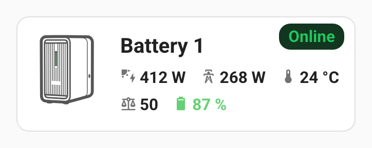
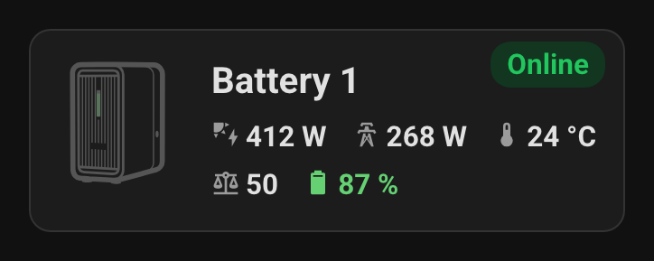
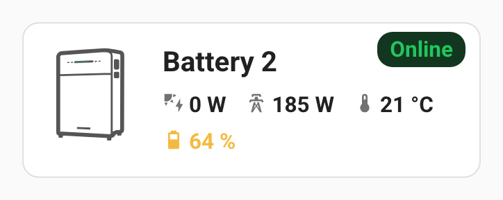
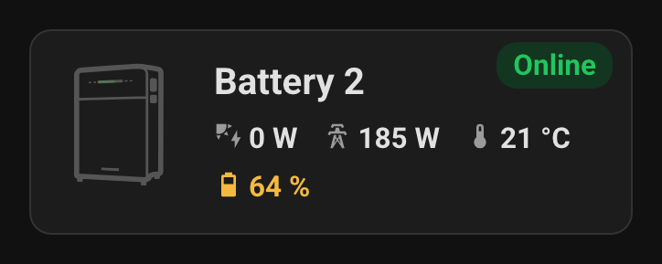

# ha-marstek-battery-card

Lovelace custom card for Marstek batteries, built for the B2500 HMJ-2 (icons also for the Jupiter C and Venus D/E, see [Device (icon)](#device-icon)): solar input, output, SOC, AstraMeter distribution weight and max. cell temperature in one compact tile — with a SOC level icon (pulsing while the battery is active), an online badge and a more-info click on every value.

A single JS file, **no dependencies** — no `button-card`, no `card-mod`.

| Light | Dark |
|---|---|
|  |  |
|  |  |

*Top: B2500 (entities derived from the hm2mqtt naming scheme). Bottom: Venus E (`model: venus_e`, entities set individually). Screenshots use invented values.*

This repo contains two files:

1. **`ha-marstek-battery-card.js`** — the card, including a visual editor.
2. **`button-card-export.yaml`** — **historical reference**, the production solution based on [`custom:button-card`](https://github.com/custom-cards/button-card) until the switch to the JS card. The JS card is a visually identical port of it (same font sizes — base `1.2rem` like button-card, title `1.05em`, values `0.82em` —, colors and spacing). No longer maintained.

## Requirements

- Marstek B2500 HMJ-2, connected through one of these sources:
  - [hm2mqtt](https://github.com/tomquist/hm2mqtt) (Marstek cloud → Hame Relay → MQTT), entities `sensor.hame_energy_hmj_2_<mac>_*`
  - [esphome-b2500](https://github.com/tomquist/esphome-b2500) as a local BLE bridge, entities named after the device name set in ESPHome
- Or another Marstek battery (Jupiter C, Venus D, Venus E) from any source — then set `model` and configure every entity individually
- Optional: the AstraMeter integration for distribution weight and active switch — without it, simply set `show_weight: false` and leave `switch_entity` empty

## Configuration

| Option | Type | Default | Description |
|---|---|---|---|
| `entity` | string (required) | — | SOC sensor of the battery |
| `name` | string | derived from the friendly name | Tile title |
| `model` | string | `b2500` | Device whose icon is shown — see [Device (icon)](#device-icon) |
| `show_input` | boolean | `true` | Show solar input |
| `show_output` | boolean | `true` | Show output |
| `show_soc` | boolean | `true` | Show the SOC value (the level icon is always shown regardless) |
| `show_weight` | boolean | `true` | Show the AstraMeter distribution weight |
| `show_temperature` | boolean | `true` | Show the max. cell temperature |
| `input_entity` | string | derived | Set the input sensor |
| `output_entity` | string | derived | Set the output sensor |
| `temperature_entity` | string | derived | Set the temperature sensor |
| `weight_entity` | string | derived | Set the distribution weight |
| `switch_entity` | string | derived | Set the active switch (only controls greying out the values) |
| `online_entity` | string | — | Connection entity for the online badge |

In the visual editor, the last six options live in the collapsed **"Optional entities"** accordion; the visibility toggles are under **"Display"**.

### Entities: derived or set individually

If only `entity` is set, the card derives the other entities from the **hm2mqtt naming scheme** (prefix `<p>` = `entity` without the `sensor.` domain and without the `_host_battery_soc` suffix):

| Value | Derived entity |
|---|---|
| Input | `sensor.<p>_total_input_power` |
| Output | `sensor.<p>_total_output_power` |
| Temperature | `sensor.<p>_temperature_max` |
| Distribution weight | `number.astrameter_consumer_<p>_distribution_weight` |
| Active switch | `switch.astrameter_consumer_<p>_active` |

AstraMeter entities drop the `hame_energy_` part of the prefix — the derivation already accounts for that.

> **The derivation does not work for other sources.** The entities of an ESPHome BLE bridge are named after the device name set in ESPHome (e.g. `sensor.<device>_battery_level`) and do not match the hm2mqtt scheme. In that case, set every value entity individually in the accordion — and `name` as well, since the automatic title cleanup is also tailored to the hm2mqtt scheme.

> **The `_host_battery_soc` suffix is mandatory as soon as anything is derived.** Another SOC sensor of the same battery — e.g. `_battery_percentage` — reports the same percentage, but the derivation strips nothing and builds entity IDs such as `sensor.<p>_battery_percentage_total_input_power` that do not exist. In this case the card raises a configuration error naming the affected keys, instead of silently showing empty values. If all derived entities are set individually anyway, the suffix does not matter and is not checked.

### Device (icon)

With `model`, the card shows a different Marstek device instead of the B2500. The icons come from [RothMick/icons4homey](https://github.com/RothMick/icons4homey); `+` / `++` are the variants with one or two extension packs.

| `model` | Icon |
|---|---|
| `b2500` (default) | B2500 — extension packs are deliberately not shown for the B2500 |
| `jupiter_c`, `jupiter_c+`, `jupiter_c++` | Jupiter C without / with 1 / with 2 extension packs |
| `venus_d`, `venus_d+`, `venus_d++` | Venus D without / with 1 / with 2 extension packs |
| `venus_e` | Venus E |

The green bar in the icon shows the SOC: it fills from left to right, the unfilled part stays grey. The number of extension packs is **not detected** but set by choosing the `model`. Entity derivation only knows the B2500 scheme of hm2mqtt; for the Venus and Jupiter, set every entity individually.

In the editor, the choice is labelled **"Device (icon)"**.

### Online badge

Without `online_entity`, a battery counts as online when SOC **and** distribution weight report a usable state (not `unavailable`/`unknown`). That fits hm2mqtt, where entities become unavailable when the connection drops, while a plain numeric value would just freeze.

With an **ESPHome BLE bridge this heuristic does not hold**: when the BLE connection drops, the sensors keep their last value and stay available — the badge would wrongly stay green, exactly in the case it is meant for. That is what `online_entity` is for: point it directly at the bridge's connection entity, usually `binary_sensor.<device>_ble_connected`. When it is set, the badge mirrors its state — `off`, `unavailable` or `unknown` mean offline. This covers both failure modes: a dropped BLE connection as well as a bridge that went offline entirely.

The option also works with any other source that reports a real connection status; a regular sensor works too (any value other than `off`/`unavailable`/`unknown` counts as online).

## Examples

Derived from the SOC sensor (hm2mqtt):

```yaml
type: custom:ha-marstek-battery-card
entity: sensor.hame_energy_hmj_2_aabbccddeeff_host_battery_soc
name: Battery 1
```

Entities set individually (ESPHome BLE bridge):

```yaml
type: custom:ha-marstek-battery-card
entity: sensor.b2500_battery_level
name: Battery 1
input_entity: sensor.b2500_total_input_power
output_entity: sensor.b2500_total_output_power
temperature_entity: sensor.b2500_temperature_max
weight_entity: number.astrameter_consumer_hmj_2_aabbccddeeff_distribution_weight
switch_entity: switch.astrameter_consumer_hmj_2_aabbccddeeff_active
online_entity: binary_sensor.b2500_ble_connected
```

See also [`example-card.yaml`](example-card.yaml).

The value row wraps automatically via `flex-wrap` when the tile runs out of space.

## Installation

### HACS

1. HACS → ⋮ → **Custom repositories** → add this repository's URL, category **Dashboard**
2. Search for **Marstek Battery Card** in HACS and download it
3. HACS adds the dashboard resource automatically; hard-reload the browser once

### Manual

Copy the file to `/config/www/ha-marstek-battery-card/` and add it as a dashboard resource of type **JavaScript module**:

```
/local/ha-marstek-battery-card/ha-marstek-battery-card.js?v=0.1.0
```

The `?v=` query parameter is the cache buster — set it to the new version number on every update and hard-reload the browser once.

## Changelog

| Version | Change |
|---|---|
| v0.1.0 | Initial public release. SOC, solar input, output, cell temperature and AstraMeter distribution weight in one tile; SOC level icon with pulse while active; online badge (optionally driven by a connection entity such as an ESPHome BLE bridge's `*_ble_connected`); entity derivation from the hm2mqtt naming scheme with per-entity overrides and a clear error when derivation cannot work; values formatted like the rest of HA (`hass.formatEntityState`); more-info on every value (also inside browser_mod popups); `model` option with icons for the B2500, Jupiter C / C+ / C++, Venus D / D+ / D++ and Venus E; visual editor |

## License

MIT, see [LICENSE](LICENSE).
